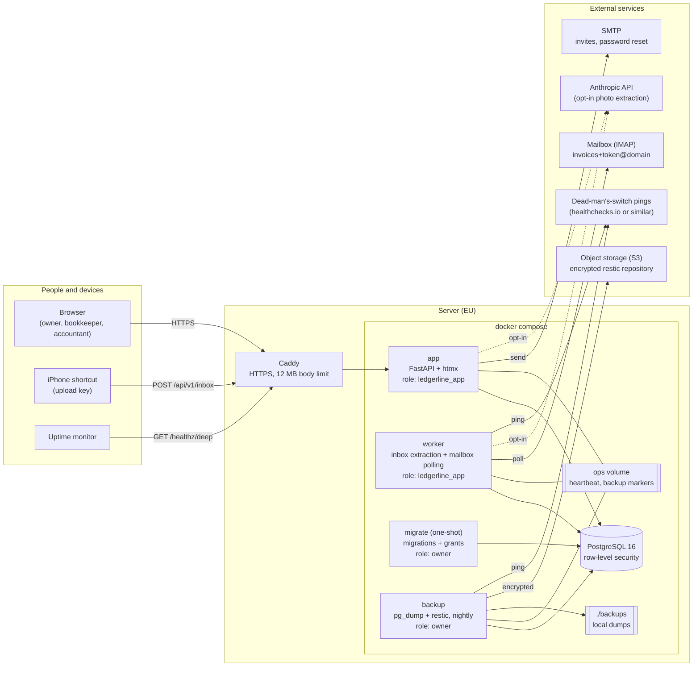
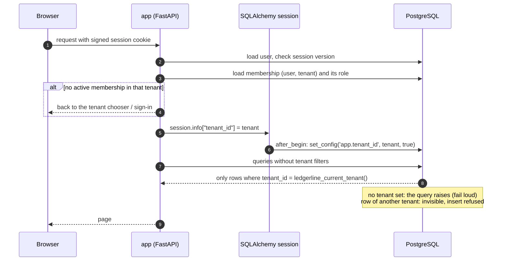
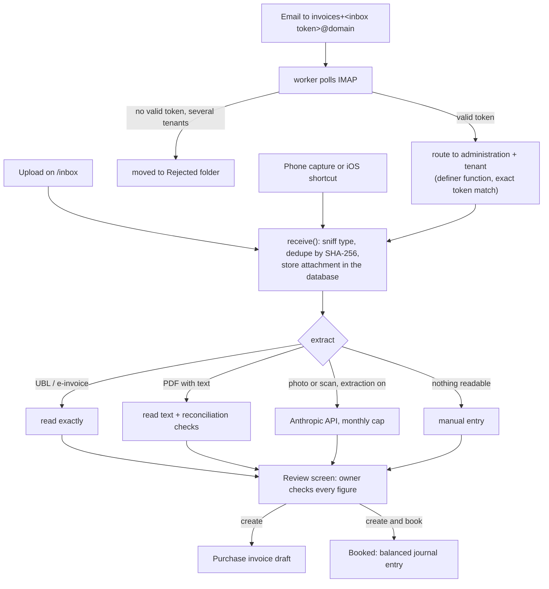
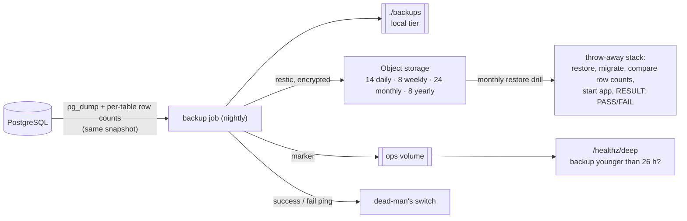

# Architecture

How Ledgerline is put together and deployed. Decisions behind it are in [docs/adr](adr); how to
run it is in [OPERATIONS.md](OPERATIONS.md).

## 1. Deployment (one server)

Everything runs on one Linux server (Hetzner Cloud in the reference setup) from
`docker-compose.yml`. Only Caddy is reachable from the internet.

Not connected on purpose: banks (statements are uploaded as CAMT.053/MT940/CSV files), the
Belastingdienst (the VAT return is prepared, the owner files it in Mijn Belastingdienst Zakelijk)
and Peppol (UBL files are generated, not sent).

| Service | Runs as | Purpose |
|---|---|---|
| `migrate` | database owner | Runs migrations and `ensure-app-role`, then exits; app and worker start only after it succeeded. Also runs `delete-tenant`. |
| `app` | `ledgerline_app` | Web UI, phone upload API, health endpoints. Never receives owner credentials. |
| `worker` | `ledgerline_app` | Reads new inbox documents and polls the mailbox, one tenant at a time; writes a heartbeat. |
| `backup` | database owner | Nightly dump with a row-count manifest, local copy plus encrypted off-site snapshot, weekly `restic check`. |
| `db` | — | PostgreSQL 16 with forced row-level security on every bookkeeping table. |

## 2. How a request gets its tenant

Isolation is enforced by the database, not by remembering filters in the code
([ADR 0001](adr/0001-multi-tenancy.md)).

Writes are allowed for `owner` and `bookkeeper`; user management, devices, business details
and new administrations are `owner` only; `accountant` is read-only. Foreign keys between
bookkeeping tables are composite `(tenant_id, id)`, so a row can never point into another tenant.

## 3. Document intake

## 4. Backups and restore

A restore brings back tenants that were deleted after the backup was taken: re-run
`delete-tenant` for every tenant in the offboarding log afterwards (OPERATIONS.md, Restore).

## 5. Code map

| Package | Responsibility |
|---|---|
| `ledgerline.ledger` | Double-entry posting, chart of accounts, period lock (rules also enforced by database triggers) |
| `ledgerline.invoicing` | Sales and purchase invoices, PDF (WeasyPrint), UBL export |
| `ledgerline.banking` | CAMT.053 / MT940 / CSV import, matching, SEPA payment files |
| `ledgerline.vat` | VAT codes, return per rubriek with sources (`vat/sources.py`), ICP |
| `ledgerline.reports` | Dashboard, P&L, balance sheet, aged debtors and creditors |
| `ledgerline.inbox` | Intake, extraction pipeline, email polling, worker |
| `ledgerline.mobile` | Phone capture page, upload API, device tokens |
| `ledgerline.accounts` | Invitations, password reset, two-factor login |
| `ledgerline.platform` | Contacts, settings, GDPR export and anonymisation, legal pages, tenant offboarding |
| `ledgerline.onboarding` | Setup wizard, in-app user guide |
| `ledgerline.imports` | CSV import of contacts and opening items (open invoices on the start date), CLI `import-contacts` and `import-opening-items` |
| `ledgerline.ops` | Deep health check |
| `ledgerline.db`, `web`, `auth` | Tenant context per transaction, request dependencies, sign-in |
